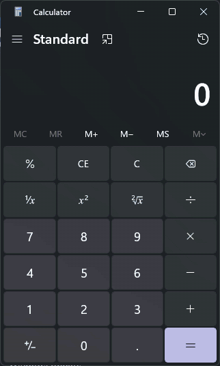

# winuse

Let your coding agent use Windows apps and websites.



winuse is a command-line tool for Windows. It reads any open window as
text, clicks and fills in its controls, and types and scrolls when a task
needs it. Any agent that can run shell commands can use it, including
Claude Code, Codex and Cursor. The commands and output follow Codex
Computer Use.

## Install

Run this in PowerShell:

```powershell
irm https://raw.githubusercontent.com/hoangvu12/winuse/main/install.ps1 | iex
```

It puts `winuse.exe` in `%LOCALAPPDATA%\winuse`, adds that folder to your
PATH, and installs the skill. It writes the skill that ships inside
`winuse.exe` to `~\.agents\skills\winuse` with `winuse skill install`, so
the skill always matches the binary. With Node.js it also runs `npx skills`
first, which links the skill into every agent it finds. Set
`WINUSE_NO_SKILL=1` to skip the skill.

Then ask your agent something like "open Calculator and work out 7 + 2
using winuse".

To build from source instead, use Go 1.27 or newer:
`$env:CGO_ENABLED=0; go build -o winuse.exe ./cmd/winuse`, then
`npx skills add hoangvu12/winuse`, or `.\winuse.exe skill install <dir>` to
write the skill into an agent's skills folder.

## How it works

The agent reads a window as a tree of elements, then acts on them by
index, `name:` or `id:`.

```
> winuse launch-app Calculator
19203320	Application Frame Host	Calculator

> winuse get-window-state 19203320
Window: "Calculator", App: CalculatorApp.exe.
	0 window Calculator Secondary Actions: Raise
	...
					14 text Display is 0 ID: CalculatorResults
	...
						46 button Seven ID: num7Button

> winuse batch 19203320 click name:Seven then click name:Plus then click name:Two then click name:Equals
Action 1 (click): ok
Action 2 (click): ok
Action 3 (click): ok
Action 4 (click): ok
```

Add `--screenshot` when the tree is not enough. winuse captures the
window where it is and leaves it behind your other windows.

## Headless and headed actions

winuse does most actions in the background, behind your work and on
minimized windows too. It clicks buttons, sets fields, check boxes and
list items, expands and toggles elements, scrolls, selects text, opens
right-click menus, runs menu-bar commands and the shortcuts a window
labels, presses Enter or Esc in a classic dialog, types into a named text
field, presses a notification's buttons, and restores, minimizes, moves,
resizes and closes windows. In Chrome, Edge and
Electron apps it also types, presses keys and clicks through window
messages. It does not move your mouse, press keys or bring the window to
the front, so you can keep working in another window. A second cursor
shows where each agent acts and what it is doing. It moves less when
Windows' animation effects are off, and `WINUSE_CURSOR_TRAIL=1` in the
helper's environment gives it a trail.

Hover, dragging, games and other apps that read raw input, and the
other gaps listed in [ADR 0013](docs/adr/0013-headless-by-readback-posted-by-opt-in.md)
need the real mouse and keyboard. winuse does those only when the agent
passes `--headed`: it waits until you pause, brings the window to the
front under a banner, and gives your window and pointer back when done;
touching the keyboard or mouse stops it. Without the flag it refuses,
sends nothing and names the `--headed` command, so it never takes your
screen on its own. `--headed` also makes any other action except a
window action work this way. Pass `--post` to send keys, text or clicks
to a background window instead, which some apps ignore.

Press Esc at any time to stop winuse. It refuses to act on administrator
windows or a locked screen, and it presses the Windows key only for
`--headed open-shell notifications` or `quick-settings`. It also
refuses Alt+F4, Alt+Tab and Ctrl+Shift+Escape unless you pass `--force`.

## Browsers

winuse also drives Chrome, Edge, Brave, Chromium, Vivaldi and Opera. With
a connection to the browser, winuse reads the page through the browser
and numbers the page's elements together with the window's own. It
clicks, types, scrolls, hovers, drags, navigates, uploads files and
answers dialogs in the page without the real mouse or keyboard, and it
opens new tabs in the background. Through the extension, each agent's
tabs gather in a tab group named after it, in its cursor's colour.

Agents work in their own tabs while you keep using yours. An agent opens
a tab with `winuse tab new <window> <url>`, which prints the tab's id, and
then names that tab as `<window>:<tab>` in every page command:
`winuse get-window-state 4242:1a2b3c4d`, `winuse click 4242:1a2b3c4d 7`.
winuse reads and acts in the tab while it stays in the background, never
switching the tab you are looking at or taking the foreground, and several
agents can work in their own tabs of one window at the same time. While an
agent works in a tab, winuse keeps it rendering and stops the browser from
freezing or discarding it; a link the agent opens there lands beside your
tab instead of replacing it. The agent's cursor does not show actions in a
tab you are not looking at.

Run `winuse browser status` to see how winuse is connected. winuse works
in the browser you already use first, with your logins and tabs:

- `winuse browser ext install <browser> --open` sets up the winuse
  extension and opens the browser's extensions page and the extension
  folder. Turn on Developer mode and drag the folder onto the page (or
  use Load unpacked), once per browser. `winuse browser ext status
  <browser> --wait 120` waits until it connects.
- `winuse browser connect` uses your running browser after its remote
  debugging switch is on and the connection is allowed; an agent you
  asked to use your browser turns the switch on and allows it with
  winuse.

When you want a separate browser instead:

- `winuse browser launch` starts the browser with a separate profile for
  winuse. A browser winuse launches or clones keeps rendering while other
  windows cover it.
- `winuse browser clone` copies your profile, logins included, and
  starts the copy.

The agent's cursor shows page actions too, gliding to the element on the
page and pressing when the click reaches it.

Without a connection, winuse reads the page through UI Automation like
any other window. Chromium builds that tree slowly the first time, so
winuse waits up to 5 s for it, once per window, in browsers and in
Electron and WebView2 apps alike. A fully covered window may not build it
at all, and winuse says so.

## Commands

| Command | What it does |
|---|---|
| `list-windows`, `list-apps` | Lists open windows, and running and recently used apps. `list-windows --details` adds each window's position, size, process id and focused, minimized, maximized or admin state; `--app <name>` lists one app's windows; `--shell` adds the taskbar, and the tray overflow, Start, the Action Center and a toast banner while open |
| `launch-app <name> [--minimized] [--arg <a>]... [--cwd <dir>] [--env K=V]... [--timeout <s>]` | Starts an app without taking the foreground and prints its window |
| `get-window-state <window> [--screenshot] [--timeout <s>]` | Prints a window's element tree, with an optional screenshot; `--timeout` gives a slow app's tree more time |
| `click`, `set-value`, `perform-secondary-action` | Clicks, fills in, picks a list item, expands or toggles an element |
| `type-text`, `press-key` | Types text or presses keys such as `Control_L+a` |
| `select-text` | Selects text in a field without keys or the mouse |
| `invoke-menu` | Runs a command of a classic menu bar, such as `"File > Save As..."`, without opening the menu |
| `scroll` | Scrolls an element by steps or into view, or scrolls at a point |
| `drag`, `hover`, `zoom` | Drags or hovers at a point or on an element, or saves a close-up of a screenshot |
| `restore-window`, `minimize-window`, `move-window`, `resize-window`, `close-window` | Manages a window without bringing it to the front |
| `--headed maximize-window` | Maximizes a window; it comes to the front, because Windows cannot maximize a window behind others |
| `close-app <app> [--force]` | Closes every window of an app and waits for it to exit; `--force` ends it if it stays open |
| `batch <window> [--timeout <s>] [--stop-on-error] ... then ...` | Runs several actions in one call and prints each one's output; a failed action does not stop the rest unless `--stop-on-error`; `batch -` reads it from stdin, one action per line; `in <window>` before an action runs it in another Window, `in new` in the one the action before opened |
| `navigate`, `back`, `forward`, `reload` | Opens a URL or moves through a tab's history |
| `wait`, `eval` | Waits for an element, text, URL, load or download, or runs JavaScript in the page (`--file` reads it from a file, `--max` prints up to 100000 characters) |
| `wait window`, `wait <window> <element> <state>`, `wait <ms>` | Waits for a Window to show or close, for text in any Window, for an Element to become enabled, disabled, gone, checked, expanded or reach a value, or pauses |
| `dialog`, `upload` | Answers a JavaScript dialog, or gives files to a file input |
| `tab list`, `tab new`, `tab switch`, `tab close` | Manages a browser window's tabs; every page command also takes `<window>:<tab>` to work in a tab in the background |
| `clipboard-get`, `clipboard-set`, `clipboard-clear` | Reads, replaces or empties the clipboard: text, an image as a PNG file, or a list of files |
| `list-displays`, `screenshot --display <n>` | Lists the displays with their position, size and scale, or takes a screenshot of one |
| `list-notifications`, `notification-action`, `notification-dismiss`, `wait notification` | Lists the notifications the toast banners show, presses a notification's button or closes it without the foreground (refused when the notification changed since it was listed), or waits for one |
| `--headed open-shell start\|notifications\|quick-settings\|overflow` | Opens Start, the notification panel, quick settings or the hidden tray icons, the way a person would; refused with nothing sent without `--headed` |
| `browser status`, `browser ext install`, `browser launch`, `browser clone`, `browser connect` | Connects to a browser and reports how |
| `status` | Prints the versions (and both builds when the helper is another build of this version), whether the helper runs, the lock state, integrity level, DPI awareness, browser connections and Windows build, without starting anything |
| `--trace <file>`, `trace show <file>` | Records one JSON line per command (or set `WINUSE_TRACE`), with typed text, values, clipboard content and eval redacted unless `--trace-unredacted`, rolling over at 32 MiB; `trace show` prints a summary |

[SKILL.md](skills/winuse/SKILL.md) is the full guide your agent loads.
`winuse skill` prints the copy built into your binary, so it always
matches the version you run.

## More

- [docs/codex-parity.md](docs/codex-parity.md) compares winuse with Codex Computer Use.
- [CONTEXT.md](CONTEXT.md) and [docs/adr/](docs/adr/) record the terms and design decisions.
- [test/e2e/README.md](test/e2e/README.md) and [tasksuite/README.md](tasksuite/README.md) describe the tests.

winuse runs on Windows only, sends no telemetry and is MIT licensed.
